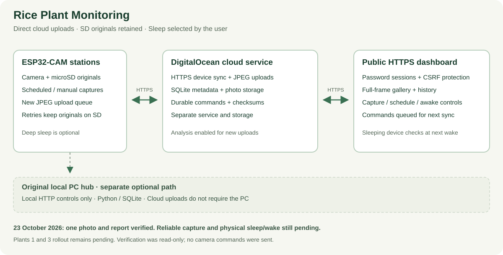

# Rice Plant Monitoring

**Three ESP32 cameras with SD originals, a local monitoring hub, and a separate cloud dashboard.**

[](https://github.com/mrsneaky29/Rice-Plant-Monitoring/actions/workflows/checks.yml)
[](https://github.com/mrsneaky29/Rice-Plant-Monitoring/actions/workflows/cloud.yml)


Rice growth is gradual; useful observations need to survive gaps in computer availability. Each ESP32-CAM retains photographs on its microSD card. The original PC hub provides local synchronization, browsing, and optional analysis. The separate [`cloud/`](cloud/README.md) implementation adds direct HTTPS uploads and a password-protected dashboard on a DigitalOcean droplet.

The project grew through physical assembly, firmware flashing, live camera tests, network troubleshooting, and changes to how data is retained. It is a working prototype with documented limitations and a reproducible source build.



The diagram includes the dated 18 October rollout checkpoint; the current verification table below records the later settings and outstanding issues.

The main path is ESP32 → verified HTTPS → DigitalOcean service → private browser dashboard. Commands travel back at the next device sync or wake. The original local PC hub remains a separate optional path, rather than a required bridge.

## Current cloud verification — 22 October 2026

| Area | Verified state |
| --- | --- |
| Dashboard | Deployed; full photo cards; capture-time display, gallery order and date filters use camera filename timestamps |
| Plant 2 | Three direct cloud captures verified on 18 October; on 22 October, daytime gaps and two reset-interrupted capture commands were observed; reliable hourly capture is not established |
| Original photographs | Retained on SD; automatic legacy-file relocation disabled; historical uploads require explicit opt-in |
| Upload recovery | New captures use temporary files and durable upload markers; acknowledgement retains the original |
| Photo protection | Delete/erase controls blocked in the cloud firmware build; no destructive route was invoked during validation |
| Sleep | Plant 2 now reports enabled with a one-hour interval; reliable full wake/capture/upload/sleep acceptance remains pending |
| Plants 1 and 3 | Cloud firmware rollout deferred; no current cloud-operation claim for either board |
| Automatic analysis | Enabled for new ordinary uploads with verified `gpt-6.1-sol` account access; historical imports excluded; first complete live analysis/report cycle awaits a successful new upload |

Local HTTP status can time out while cloud reporting continues. Power-cut recovery, weak-Wi-Fi stress tests, SD file-by-file integrity checks and the current camera-reset cause remain outstanding. The live backend retains its original release with targeted analysis startup/archive safeguards and a worker update; other server/backup improvements in source may still await deployment. No camera firmware or settings changed during the 22 October follow-up.

## Original local-hub operation

1. Each configured station takes an hourly photograph and saves it locally.
2. The PC hub discovers cameras on the same Wi-Fi, including cameras whose IP addresses changed.
3. It downloads the photo history, alternating between stations, and records progress in SQLite.
4. The dashboard shows each plant's latest photograph, connection status, SD capacity, and available analysis history. **Take photo now** requests a fresh image from a specific camera.
5. When the PC stops, the dashboard becomes unavailable. The powered ESPs continue recording to SD and synchronize again when the hub returns.

The historical local-hub deployment used **Camera-only mode**. Earlier soil-moisture and DHT22 support remains in the source. In the original firmware the boards stay powered; its hourly schedule controls capture. The cloud firmware adds optional deep sleep. Both variants include a one-time Camera-only role migration; later explicit sensor roles remain supported. Physical wiring does not prove an enabled sensor profile.

## Features

| Feature | Implementation |
| --- | --- |
| Independent recording | Camera and microSD storage on each ESP32-CAM |
| Persistent identities | `plant-1`, `plant-2`, and `plant-3`, with saved names and OTA hostnames |
| Automatic discovery | UDP announcements, startup broadcasts, and periodic rediscovery |
| Manual capture | Per-camera dashboard button that saves to SD and queues synchronization |
| Durable local storage | SQLite WAL transactions, staged `.part` downloads, and JPEG boundary checks |
| Recoverable analysis | Stored background response IDs, JSON result sidecars, and rolling database backups |
| Local dashboard | Gallery, queue, plant cards, storage, settings, and available analysis graphs |
| Optional image analysis | Structured tiller-count checks, growth-stage estimates, water-level estimates, and confidence fields |
| Direct cloud operation | Per-device authenticated HTTPS reports/uploads and password-protected remote controls; verified on Plant 2 |
| Protected cloud captures | New-photo upload intents, retained SD originals, blocked photo deletion and historical uploads off by default |
| Optional cloud sleep | Queued settings, timer wake and RESET maintenance; physical sleep/wake acceptance pending |

## Run the PC hub

### Optional cloud deployment

The separate [`cloud/`](cloud/README.md) implementation adds a password-protected
dashboard, direct ESP32 HTTPS photo uploads, queued remote controls, and optional
scheduled deep sleep with RESET-button maintenance access. It uses a dedicated
service and storage on the existing cloud server; no PC bridge is required.
Original hub/firmware files below remain available unchanged. See the cloud
README for private provisioning, station-specific OTA builds, tests, backup
restoration, and the physical acceptance checks required before enabling sleep.

### Original local hub

The hub runtime uses the **Python standard library**. Install Python 3.12 or newer and run this command from the repository root:

```powershell
py -3 PC_Hub/Monitoring_Hub.py --open-browser
```

Open **http://localhost:8765** on the host. Other devices on the same Wi-Fi can open `http://<PC-LAN-IP>:8765`. Allow the application's private-network firewall prompt so station discovery and local access can work.

On Windows, `PC_Hub/Open Monitoring Hub.bat` launches either the packaged executable or the Python source and opens the browser. The executable runs as a background web server; it does not create a separate desktop window. A second launch opens the existing dashboard instead of starting another hub.

The hub creates photographs, queue state, backups, and optional API-key files in **`PC_Hub/data/`**. That folder is ignored by Git. Preserve it when upgrading or moving your installation.

## Prepare the hardware

You need AI Thinker ESP32-CAM boards with PSRAM, compatible camera modules, microSD cards, stable power, and 2.4 GHz Wi-Fi. The original configuration targets OV5640; Plant 2's current cloud boot log detects an OV3660. Check the detected sensor and board configuration rather than assuming all modules are identical.

The following steps prepare the **original local-hub firmware**. For direct cloud operation, follow the separate [cloud provisioning and OTA instructions](cloud/README.md#private-provisioning-and-camera-builds); the variants have different upload and photo-protection behavior.

1. Copy `ESP32_Station/secrets.example.h` to `ESP32_Station/secrets.h` and fill in your Wi-Fi and OTA credentials. The local file is excluded from Git.
2. Open `ESP32_Station/ESP32_Station.ino` in Arduino IDE. Select **AI Thinker ESP32-CAM**, **DIO** flash mode, and install **ArduinoJson 7.4.3**. Keep the supplied `partitions.csv` beside the sketch; it defines two OTA application slots.
3. Flash each board using a serial programmer or an already configured OTA connection. After serial flashing, disconnect GPIO0 from GND and restart the board.
4. Use the hub's **Device setup** panel to assign distinct Plant 1, Plant 2, and Plant 3 identities by current IP address. Restart each board to apply its identity.
5. Enable the one-hour timer on each ESP's web page if needed. Fresh installations default to a disabled timer, with an interval of 3,600 seconds. Take a manual photo to verify capture and SD storage.

The firmware applies a one-time migration from existing sensor profiles to Camera-only while preserving Wi-Fi settings, identities, schedules, and SD photographs. OTA requires a running board connected to the network. See [setup and troubleshooting](docs/setup.md) for build commands and common failures.

Historical wiring identifies Plant 1 by ADS1115 on GPIO3/RX0 and GPIO1/TX0, Plant 2 by DHT22 data on GPIO13, and Plant 3 by its lack of an assigned external sensor. Confirm identity and MAC before each update. Working OTA firmware permits wireless updates; a fresh or unreachable board may require serial access.

## Optional photo analysis

In the original hub, analysis runs on the PC after an image is downloaded. Supply `OPENAI_API_KEY` in the hub environment or save a key through its dashboard to enable that integration. The separate cloud service has an optional asynchronous analysis worker, currently disabled in the live deployment; see [cloud analysis configuration](cloud/README.md#optional-analysis).

The settings expose model, reasoning effort, and one to three tiller-count checks. Their configured model identifiers reflect the original development environment; verify availability and reasoning support in your API account before enabling paid requests. By default, photographs created before the hub's first analysis cutoff are synchronized as history rather than automatically analyzed. New photos are eligible, and reanalysis is an explicit action.

Count checks occur within **one model response**, not separate independently sampled requests. Their selected length is enforced by the structured output schema. Outputs include confidence and notes; an obscured stem base or unreadable ruler may not support a reliable estimate. The project does not claim benchmarked counting accuracy or agronomic validation.

## Engineering decisions

- **Retain originals at the source.** Every ESP keeps its photographs on SD, so PC downtime does not stop recording or remove the original data.
- **Separate identity from address.** Station numbers persist while DHCP addresses can change. Discovery reconnects the two.
- **Record the work queue.** Downloads and analyses have explicit states, making interrupted work inspectable and recoverable.
- **Stage downloads before acceptance.** Images arrive in temporary files and are renamed only after validation.
- **Keep observation and interpretation distinct.** Photographs are primary records; model outputs are estimates that can be revisited.

The [engineering record](docs/engineering.md) explains recovery behavior, validation evidence, remaining failure windows, and useful next experiments.

## Validation

The development session on **14 September 2026** verified all three physical stations online with healthy camera and SD status, Camera-only profiles, and enabled 3,600-second timers. Manual captures from Plants 2 and 3 produced complete JPEGs of **302,654 bytes** and **177,926 bytes** respectively. Firmware compilation and packaged hub startup were also checked in that session.

The publication copy includes isolated tests for queue/schema defaults, manual capture routing, sidecar recovery, sensor-history association, truncated-image rejection, and duplicate-launch handling. Run them with:

```powershell
py -3 -m unittest discover -s PC_Hub -p "test_*.py" -v
node scripts/check-dashboard.cjs
```

GitHub Actions runs the hub tests, checks dashboard JavaScript, and compiles the firmware with example credentials. Historical hardware observations do not imply continuous uptime or current device availability.

Cloud validation also covers isolated server, import, backup, publication and restoration regressions, dashboard tests, and ESP32 compilation. Run the cloud suite after installing `cloud/server/requirements-dev.txt`:

```powershell
python -m pytest cloud/server/tests cloud/deploy/test_sd_import.py cloud/deploy/test_pull_camera.py cloud/review_tests -q
node --test cloud/server/tests/static_client.test.cjs
```

## Source map

```text
ESP32_Station/                 Camera firmware, SD storage, Wi-Fi, OTA, and timers
PC_Hub/Monitoring_Hub.py        Discovery, synchronization, persistence, and HTTP API
PC_Hub/static/index.html        Local dashboard and camera controls
PC_Hub/test_hub.py              Isolated tests with temporary storage
cloud/                         Separate cloud server, firmware, tests and deployment tools
docs/                          Architecture, setup, and engineering record
scripts/                       Source validation helpers
.github/workflows/             Automated checks
```

## Current limits

The original hub and local ESP control endpoints are trusted-LAN interfaces and must not be exposed to the public internet. The cloud dashboard uses password sessions and CSRF protection; devices authenticate with individual credentials. SD storage is retained until capacity is exhausted. Comprehensive power-cut testing and labelled image-analysis evaluation remain future work. The cloud analysis worker marks ambiguous submissions uncertain rather than automatically retrying a potentially paid request; the original hub has a separate submission/persistence failure window.

Source backups in Drive exclude credentials, photographs, databases and compiled firmware. They are not monitoring-data backups. Cloud data backups currently remain on the same droplet; a separate offsite data backup is still needed. Never format a card or assume a diagnostic zero count establishes missing photos.

## Development and attribution

This project was developed with AI-assisted implementation and debugging alongside hands-on board setup, flashing, and hardware validation. The repository documents the implemented system and its evidence; it does not imply that every line was written manually or that the system has demonstrated crop-yield improvements.

The firmware uses Espressif's Arduino ESP32 ecosystem and camera APIs. Dependencies retain their own licenses, and existing source notices are preserved. A repository-wide redistribution license has not yet been assigned pending an attribution review.
